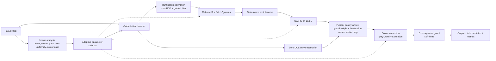

# Design Document - P1 Robust Low-Light Image Restoration

## 1. Problem & goals
Enhance severely under-exposed, noisy, colour-distorted and non-uniformly lit images while preserving edges/textures and avoiding overexposure, halos and colour shifts.

## 2. System architecture

Code map: `lowlight/classical.py` (classical branch) - `lowlight/zerodce.py` (DL branch) - `lowlight/pipeline.py` (hybrid fusion, ablation flags) - `lowlight/metrics.py` - `app.py` (UI) - `scripts/{train,evaluate,make_samples}.py`.

## 3. Classical branch
- **Illumination decomposition:** S = R * L. L = guided-filter-refined max-RGB (edge-aware, avoids halos). R = S / L.
- **Retinex enhancement:** L' = L^gamma, output R*L'. gamma adapts to severity (0.85 -> 0.40).
- **Denoising:** guided filter before enhancement (eps from measured noise sigma) and again after, weighted by the per-pixel gain Le/L so noise is smoothed *where it was amplified*.
- **CLAHE** on Lab lightness, clip limit and mix reduced when noise is high.
- **Colour/contrast:** partial gray-world gain (strength from measured colour cast) + saturation recovery.

## 4. Deep branch
Zero-DCE DCE-Net (7 conv, 8-iteration quadratic LE curves, ~79k params) with spatial-consistency, exposure, colour-constancy and illumination-smoothness losses. `scripts/train.py` supports unsupervised training on LOL/LOL-v2/FiveK-dark images and paired L1 fine-tuning; 90/10 train/val split. Weights shipped in `weights/` are only a *bootstrap on synthetic data* - **retrain on LOL for reportable numbers**.

## 5. Hybrid intelligence
1. Classical denoise precedes DL so the network does not amplify noise.
2. Quality-aware gate: each candidate (DL, classical) gets a no-reference score (entropy + contrast - noise - saturation - exposure error); a softmax gives the global DL weight.
3. Spatial gate: weight map = g_DL * (0.4 + 1.2 * L_norm): dark regions lean on Retinex (stronger local lift, extreme/non-uniform darkness), bright regions on DL (avoids overexposure).
4. Shared colour correction and soft-knee overexposure guard applied after fusion.

## 6. Adaptive strategy
`analyze()` measures mean luma, dark ratio, dynamic range, noise (Immerkaer), non-uniformity, colour cast -> `adaptive_params()` sets gamma, CLAHE clip/tile/mix, denoise radius/eps, colour strength, saturation. Fixed-parameter baseline is available (`adaptive=False`) and appears in the ablation.

## 7. Evaluation protocol
`scripts/evaluate.py` -> `eval_P1_<TEAM>.md`: PSNR, SSIM, LPIPS, NIQE (pyiqa), latency, noise suppression (`noise_rel`), edge preservation (gradient correlation), overexposure %, colour cast, Delta-E. Compares classical / DL / hybrid and 9 ablations. Test on unseen data: train on LOL-v1 `our485`, evaluate on LOL-v2 and `eval15`.

## 8. Deployment
Gradio app, Docker (port 7860), Hugging Face Spaces compatible. Inputs are capped at 1280 px (UI path 1024 px) for ~<10 s response; non-RGB / RGBA / grayscale inputs handled; errors surface as UI toasts.

## 9. Limitations & ethics
Heuristic fusion weights are hand-designed, not learned. NIQE/LPIPS rely on external pretrained models. Enhancement can reveal content intentionally hidden by darkness (privacy), and can alter evidentiary images - outputs must not be used as forensic evidence. Synthetic bootstrap weights are weak; real-data performance depends on retraining.

## 10. Team contributions
| Member | USN | Part |
|---|---|---|
| (fill) | | Classical branch |
| (fill) | | Deep branch / training |
| (fill) | | Fusion / evaluation |
| (fill) | | UI / deployment / docs |
